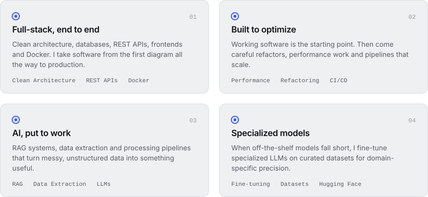
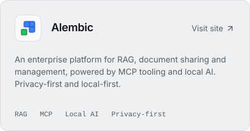
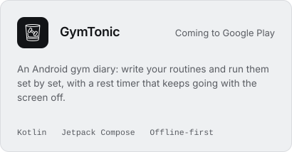
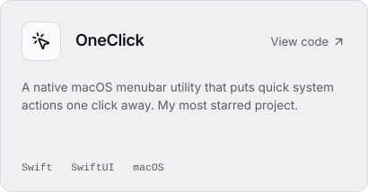
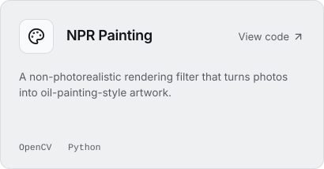
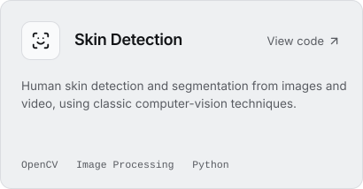
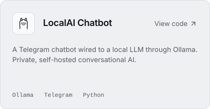
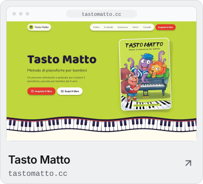
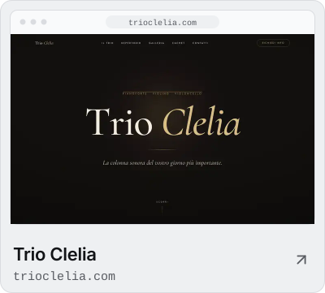

<a href="https://mik3sw.github.io"><picture><source media="(prefers-color-scheme: dark)" srcset="./assets/header-dark.svg"></picture></a>

  <a href="https://mik3sw.github.io"><picture><source media="(prefers-color-scheme: dark)" srcset="./assets/btn-website-dark.svg"></picture></a>&nbsp;
  <a href="https://www.linkedin.com/in/michele-angelo-marcucci/"><picture><source media="(prefers-color-scheme: dark)" srcset="./assets/btn-linkedin-dark.svg"></picture></a>&nbsp;
  <a href="https://huggingface.co/mik3ml"><picture><source media="(prefers-color-scheme: dark)" srcset="./assets/btn-huggingface-dark.svg"></picture></a>&nbsp;
  <a href="https://www.linkedin.com/in/michele-angelo-marcucci/overlay/1767093719439/single-media-viewer/?profileId=ACoAACX59jEBhAPYj2ps2wksT7dUyJ0XUSN2iiA"><picture><source media="(prefers-color-scheme: dark)" srcset="./assets/btn-cv-dark.svg"></picture></a>

 

<picture><source media="(prefers-color-scheme: dark)" srcset="./assets/section-1-dark.svg"></picture>

I design, build and optimize software end to end, and reach for AI when a problem calls for it. I studied Information Technology at the University of Milano-Bicocca.

<picture><source media="(prefers-color-scheme: dark)" srcset="./assets/principles-dark.svg"></picture>

  

<picture><source media="(prefers-color-scheme: dark)" srcset="./assets/section-2-dark.svg"></picture>

  <a href="https://www.redixlabs.ai/alembic"><picture><source media="(prefers-color-scheme: dark)" srcset="./assets/project-alembic-dark.svg"></picture></a>
  <picture><source media="(prefers-color-scheme: dark)" srcset="./assets/project-gymtonic-dark.svg"></picture>

  <a href="https://github.com/mik3sw/OneClick"><picture><source media="(prefers-color-scheme: dark)" srcset="./assets/project-oneclick-dark.svg"></picture></a>
  <a href="https://github.com/mik3sw/NPR-Painting"><picture><source media="(prefers-color-scheme: dark)" srcset="./assets/project-npr-dark.svg"></picture></a>

  <a href="https://github.com/mik3sw/SkinDetection"><picture><source media="(prefers-color-scheme: dark)" srcset="./assets/project-skin-dark.svg"></picture></a>
  <a href="https://github.com/mik3sw/LocalAI-chatbot"><picture><source media="(prefers-color-scheme: dark)" srcset="./assets/project-localai-dark.svg"></picture></a>

 

<picture><source media="(prefers-color-scheme: dark)" srcset="./assets/section-3-dark.svg"></picture>

Sites I designed and built, live in production.

  <a href="https://www.redixlabs.ai"><picture><source media="(prefers-color-scheme: dark)" srcset="./assets/site-redixlabs-dark.svg"></picture></a>
  <a href="https://tastomatto.cc"><picture><source media="(prefers-color-scheme: dark)" srcset="./assets/site-tastomatto-dark.svg"></picture></a>
  <a href="https://trioclelia.com"><picture><source media="(prefers-color-scheme: dark)" srcset="./assets/site-trioclelia-dark.svg"></picture></a>

 

<picture><source media="(prefers-color-scheme: dark)" srcset="./assets/section-4-dark.svg"></picture>

<picture><source media="(prefers-color-scheme: dark)" srcset="./assets/stack-dark.svg"></picture>

  

<picture><source media="(prefers-color-scheme: dark)" srcset="./assets/section-5-dark.svg"></picture>

<picture><source media="(prefers-color-scheme: dark)" srcset="https://github-readme-stats.vercel.app/api?username=mik3sw&count_private=true&include_all_commits=true&show_icons=true&border_radius=12&bg_color=17181b&border_color=292b2f&title_color=eff0f2&text_color=a2a5aa&icon_color=7896ff&ring_color=7896ff"></picture>
<picture><source media="(prefers-color-scheme: dark)" srcset="https://github-readme-stats.vercel.app/api/top-langs/?username=mik3sw&layout=compact&border_radius=12&bg_color=17181b&border_color=292b2f&title_color=eff0f2&text_color=a2a5aa&icon_color=7896ff&ring_color=7896ff"></picture>

  

Design and copy from <a href="https://mik3sw.github.io">mik3sw.github.io</a>. Illustration from <a href="https://www.openpeeps.com">Open Peeps</a> by Pablo Stanley (CC0).
