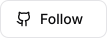
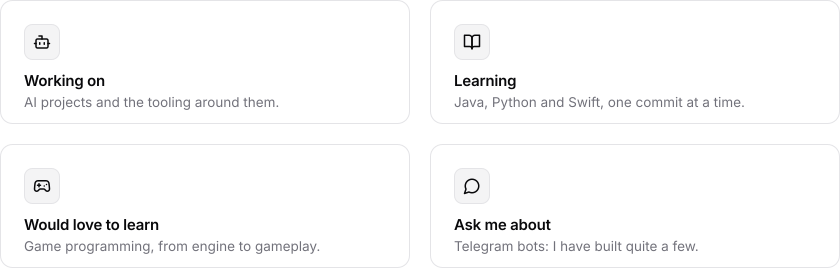

<a href="https://michelemarcucci.me">
  <picture>
    <source media="(prefers-color-scheme: dark)" srcset="./assets/header-dark.svg">
    <source media="(prefers-color-scheme: light)" srcset="./assets/header-light.svg">
    
  </picture>
</a>

  <a href="https://michelemarcucci.me"><picture><source media="(prefers-color-scheme: dark)" srcset="./assets/btn-website-dark.svg"></picture></a>&nbsp;
  <a href="https://t.me/mike_2000"><picture><source media="(prefers-color-scheme: dark)" srcset="./assets/btn-telegram-dark.svg"></picture></a>&nbsp;
  <a href="https://github.com/mik3sw?tab=followers"><picture><source media="(prefers-color-scheme: dark)" srcset="./assets/btn-github-dark.svg"></picture></a>

 

<picture>
  <source media="(prefers-color-scheme: dark)" srcset="./assets/section-about-dark.svg">
  
</picture>

Hi, I'm **Michele** 👋 a Software Engineer from Italy. I currently work as a **C# and Java developer** at **ReDiX Informatica**. Besides programming, I enjoy gaming and traveling.

<picture>
  <source media="(prefers-color-scheme: dark)" srcset="./assets/now-dark.svg">
  
</picture>

  

<picture>
  <source media="(prefers-color-scheme: dark)" srcset="./assets/section-stack-dark.svg">
  
</picture>

 

<picture>
  <source media="(prefers-color-scheme: dark)" srcset="./assets/stack-dark.svg">
  
</picture>

  

<picture>
  <source media="(prefers-color-scheme: dark)" srcset="./assets/section-stats-dark.svg">
  
</picture>

 

<picture>
  <source media="(prefers-color-scheme: dark)" srcset="https://github-readme-stats.vercel.app/api?username=mik3sw&count_private=true&include_all_commits=true&show_icons=true&hide_rank=false&border_radius=12&bg_color=09090b&border_color=27272a&title_color=fafafa&text_color=a1a1aa&icon_color=fafafa&ring_color=fafafa">
  
</picture>
<picture>
  <source media="(prefers-color-scheme: dark)" srcset="https://github-readme-stats.vercel.app/api/top-langs/?username=mik3sw&layout=compact&border_radius=12&bg_color=09090b&border_color=27272a&title_color=fafafa&text_color=a1a1aa">
  
</picture>

  

Built with ☕ and a neutral zinc palette, inspired by <a href="https://ui.shadcn.com">shadcn/ui</a>.
